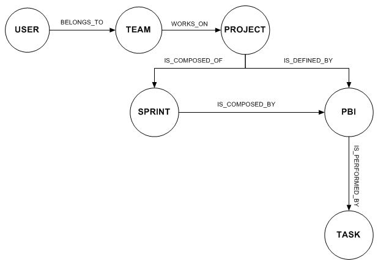
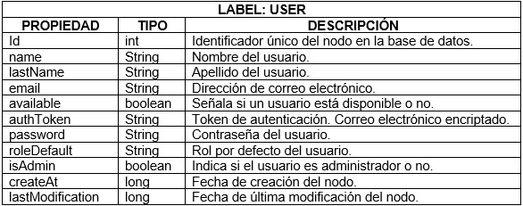
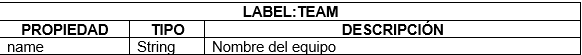
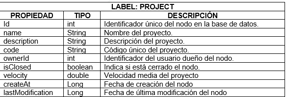
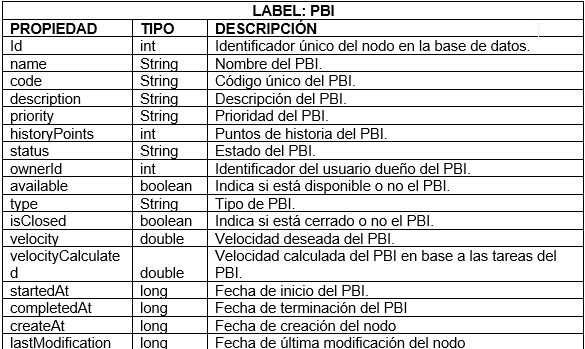
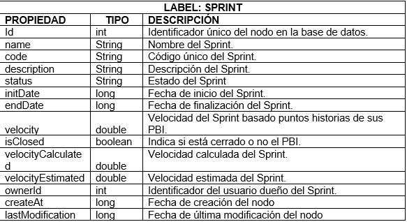
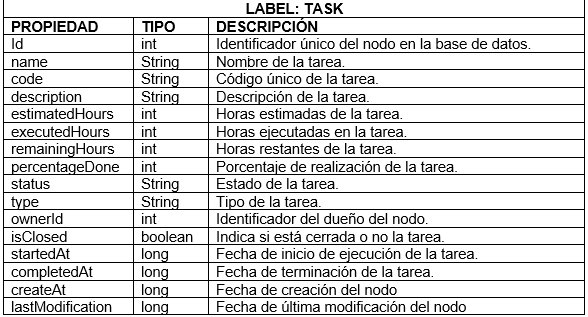

# ScrumGraph

[](https://github.com/grug-dev/scrum-graph/actions/workflows/ci.yml)

ScrumGraph is the backend of a web application built as a degree project (2015).
It is a REST API for the main Scrum elements: users, teams, projects, sprints,
product backlog items (PBI) and tasks. It stores them as a graph in Neo4j.
The graph helps a team plan the commitments of future sprints.

## Stack (branch 1.0.X)

- Java 8
- Spring Boot 1.5.9 (Spring Framework 4.3, Spring MVC, Spring AOP)
- Spring Data Neo4j 4.2 (Neo4j OGM 2.1, HTTP driver)
- JUnit 4 and Mockito for tests

Other branches:

- Tag `0.0.1`: Jersey REST services, Neo4j, Java 7.
- Branch `2.0.X`: Spring Boot, Spring Framework 5, MongoDB.

## Run it

You need Java 8, Maven and a running Neo4j 3.x server.

1. Start Neo4j. By default the app connects to `http://localhost:7474`.
2. Run the Cypher in `docs/SCRIPT_INSTALLATION` to create the constraints,
   the indexes and the default admin user.
3. Optional: run `docs/SCRIT_BD_DUMMIE.txt` to load sample data.
4. Start the app:

```bash
cd scrumgraph
export NEO4J_USERNAME=neo4j        # default: neo4j
export NEO4J_PASSWORD=your-password # default: adminneo4j
mvn spring-boot:run
```

The API runs at `http://localhost:8585/scrumgraph/sgrest`.
To use another Neo4j URI, set `SPRING_DATA_NEO4J_URI`.

## Tests

```bash
cd scrumgraph
mvn test
```

The unit tests need no database. `ScrumgraphApplicationTests` starts the
full app and needs Neo4j, so it is skipped by default. Run it with
`mvn test -Dscrumgraph.it=true`.

GitHub Actions runs `mvn test` with Java 8 on every push and pull request
to `1.0.X`.

## API

### Authentication

Each request sends the header `X-ScrumGraph-Header`. Its value is JSON:

```
X-ScrumGraph-Header: {"authToken": "<token>"}
```

The token must match the `authToken` of a `USER` node.

### Endpoints

| Method | Path     | Description    |
|--------|----------|----------------|
| GET    | `/users` | List all users |

Example:

```bash
curl -H 'X-ScrumGraph-Header: {"authToken": "<token>"}' \
  http://localhost:8585/scrumgraph/sgrest/users
```

Response:

```json
{
    "status": "OK",
    "errorMsg": "",
    "code": 200,
    "response": {
        "users": [
            {
                "id": 1,
                "name": "SUPER ADMIN SG",
                "lastName": "SCRUM GRAPH",
                "email": "superadminsg@example.com",
                "available": true,
                "admin": true
            }
        ]
    }
}
```

### Errors

Errors use the same body. `status` is `error`, `code` is the application code
and `errorMsg` says what went wrong.

| HTTP status | When                                   | `code` |
|-------------|----------------------------------------|--------|
| 400         | The header is missing or is not JSON   | 101    |
| 401         | The auth token is missing or not valid | 311    |
| 503         | The app cannot connect to Neo4j        | 503    |
| 500         | Any other error                        | 500    |

All codes are in `constants/ECodeResponse.java`.

CORS is set in `config/CorsConfig.java`. It allows any origin, the methods
`GET, POST, DELETE, PUT, OPTIONS` and the header `X-ScrumGraph-Header`.

## Design

A user belongs to a Scrum team. The team works on a project. A project has
sprints and is defined by product backlog items. A sprint works on a set of
PBIs. A PBI is done through a set of tasks.



### Nodes

- **USER**: a member of a Scrum team.
- **TEAM**: a Scrum team.
- **PROJECT**: the software project to track.
- **PBI**: a product backlog item, a feature of a project.
- **SPRINT**: an iteration of a project.
- **TASK**: a task of a PBI.

### Relationships

- **BELONGS_TO**: USER to TEAM. The users of a team.
- **WORKS_ON**: TEAM to PROJECT. The team of a project.
- **IS_DEFINED_BY**: PROJECT to PBI. The features of a project.
- **IS_COMPOSED_OF**: PROJECT to SPRINT. The iterations of a project.
- **IS_COMPOSED_BY**: SPRINT to PBI. The features worked on in a sprint.
- **IS_PERFORMED_BY**: PBI to TASK. The tasks of a feature.

### Attributes

Each node has key-value properties:








### Constraints

These properties are unique per label:

- **USER**: `email`
- **PROJECT**, **PBI**, **SPRINT**, **TASK**: `code`

## Docs

- `docs/SCRIPT_INSTALLATION`: constraints, indexes and the admin user.
- `docs/SCRIT_BD_DUMMIE.txt`: sample data with fake users.
- `docs/REST Definiciones.txt`: early notes about the planned REST resources (Spanish).
